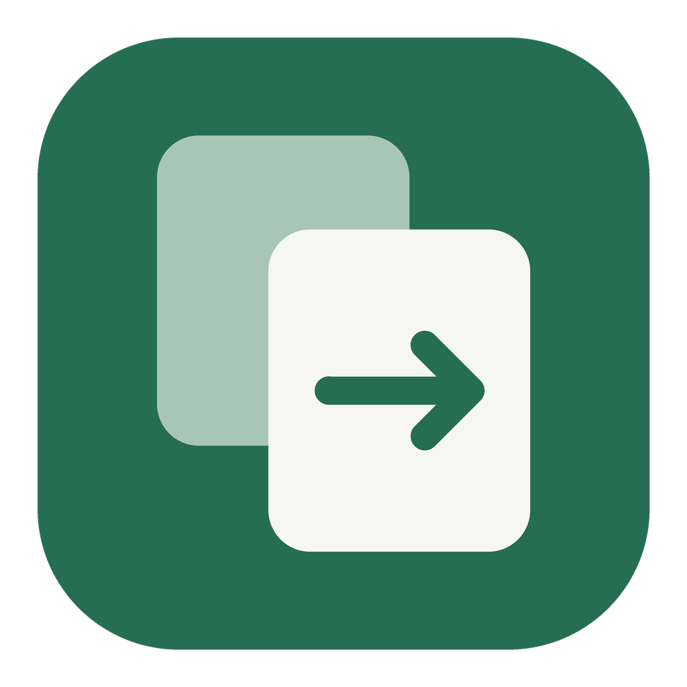

# 轻贴 · Lan Clip

[下载安装包](https://github.com/yyyzl/lan-clip/releases/latest) · [三端构建](https://github.com/yyyzl/lan-clip/actions/workflows/build.yml)

Android 手机发送文字或图片，同一局域网里的 Windows、Mac 电脑自动写入剪贴板。

## 安装

- **Windows**：下载 `Lan-Clip-Windows-x64-Setup.exe`，按安装向导操作。升级前从托盘菜单退出轻贴，再运行新版安装包。安装和卸载均保留本地配对数据；ZIP 是可选便携版。
- **Mac**：解压 universal ZIP，将 `Lan Clip.app` 放入「应用程序」，支持 Apple 芯片和 Intel，要求 macOS 12+。
- **Android**：通常选择 `arm64-v8a.apk`；v0.1.0 发布版可直接覆盖安装。更早的本地调试包需先卸载再装。

## 使用

1. 手机、电脑连接同一 Wi-Fi，分别打开轻贴。
2. 首次打开，电脑点「开始配对」，手机点「添加电脑」；之后可用首页的「添加手机」/「添加」。手机选择电脑并输入完整配对码；只有一台待添加电脑时自动选中。每台电脑只需配对一次。
3. 手机点「发送文字」，在空白输入框输入或使用系统粘贴，再点「发送」。也可以点「发送图片」，从相册选图并确认发送。
4. 所有已配对且能连接的电脑都会收到。看到发送成功，直接在目标应用按 `Ctrl+V` / `⌘V`。

手机和电脑首页均常驻显示已配对设备。绿灯「在线」表示近期通信正常，灰灯「离线」表示当前无法确认连接；离线不会移除配对。电脑约 15 秒未收到手机心跳后显示离线，恢复通信即更新。一台离线不会阻止另一台接收。发送失败会保留输入和每台电脑的结果，可直接重试。

电脑关闭窗口后驻留托盘/菜单栏，仍可接收。Windows 右键托盘图标，点「退出轻贴」；Mac 使用应用菜单退出（`⌘Q`），或从菜单栏图标退出。Windows 托盘不可用时，关闭窗口会直接退出。手机无需常驻后台，重新打开即可恢复连接。电脑睡眠时不能接收。

## 首次连接与排查

- 若系统询问本地网络访问，请允许。Windows 防火墙出现提示时，允许**专用网络**。
- 找不到电脑：检查是否为访客 Wi-Fi、路由器是否开启设备隔离；也可点「使用 IP 添加」，输入电脑配对页中的实际 Wi-Fi IPv4 地址。
- 接收使用 TCP **45877**，发现使用 UDP **45876**。防火墙必须允许轻贴程序接收这些连接。IP 手动添加可绕过广播限制，但无法绕过设备隔离。
- 完整配对码包含数字及字母，2 分钟失效，成功后立即关闭；输错 5 次需在电脑重新生成。配对码用于核验身份，不包含 IP；应用通过广播查找地址。安卓优先向实际网段的广播地址发送查找请求，未发现时可重新查找或手动输入 IP。
- 图片写入 PNG 及系统原生图片格式，目标软件本身须支持粘贴图片；纯文本编辑器无法粘贴图片。
- 不同相册格式会在手机转为 PNG。支持解码的静态图片不超过 20 MiB / 2400 万像素；文本不超过 1 MiB。动态图片按单帧处理。

## 构建

修改在独立分支开发，通过 PR 的三端构建检查后合并到 `main`；正式版本从合并后的主分支打标签发布，详见 [开发流程](AGENTS.md)。

使用 Flutter **3.47.7** / Dart **3.13.5**，项目不依赖 Rust。业务逻辑、UI、局域网协议由 Dart 实现；Swift / C++ 处理桌面图片剪贴板、托盘与窗口生命周期。

```sh
flutter pub get
flutter analyze
flutter test
```

Android（需 Android SDK、JDK 21）：

```sh
flutter build apk --release --split-per-abi
```

输出 `build/app/outputs/flutter-apk/`。GitHub Actions 使用固定发布签名，本地未配置签名时使用开发密钥；详见 [自动构建与签名](docs/build-and-signing.md)。

Windows（安装 Flutter、Visual Studio 的「使用 C++ 的桌面开发」、Windows SDK 和 Inno Setup 6）：

```powershell
./tool/build-windows.ps1
```

得到 `build/Lan-Clip-Windows-x64-Setup.exe` 安装包及 `build/Lan-Clip-Windows.zip` 便携包。推荐安装包：当前用户安装，可选桌面快捷方式，支持系统卸载，升级保留配对。便携包必须完整解压，不能只复制其中的 exe。公开仓库附带可手动运行、也可由版本标签触发的 GitHub Actions 三平台打包流程。

macOS（标准发布构建需要完整 Xcode）：

```sh
flutter build macos --release
```

输出 `build/macos/Build/Products/Release/Lan Clip.app`，需要 macOS 12 或更新版本。Actions 检查 Apple 芯片 / Intel 通用架构，并执行本地签名验证；当前未配置 Apple Developer ID 和公证。

仅有 Apple Command Line Tools 的 Mac 可执行 `./tool/build-macos-local.sh`，得到 `build/local-release/Lan Clip.app`。它使用共享原生代码和 Flutter **Release / AOT** 引擎，为当前架构生成本地签名试用包，尚未做 Apple 开发者签名和公证。传入 `debug` 参数可构建调试版本。

本机 `tool/flutterw` 会读取被 Git 忽略的 `.local.env`，便于使用独立安装的 SDK。迁移到其他机器用系统 `flutter` 即可，不依赖当前机器的绝对路径。

## 数据和协议

- 无账号、云端或互联网传输；不读取手机剪贴板。只发送用户在输入框确认的内容或选中的图片。
- UDP 仅广播设备信息；内容通过固定证书身份的 HTTPS 传输。首次配对码包含私密随机 PIN 和证书指纹片段，之后验证完整 SHA-256 指纹及配对凭证。
- 原生剪贴板写入完成后才返回成功；每台电脑独立反馈。未修改内容的重试复用消息 ID，接收端在当前进程内保留最近 128 条回执用于去重。
- 本地仅持久化设备身份、TLS 私钥和配对凭证，不保存文字/图片历史。最近收到的内容只在内存中预览；操作系统及其他剪贴板管理器可能独立保存系统剪贴板。
- 设置中可移除配对设备。重新安装或清除应用数据后需重新配对。

目录：`lib/src/core` 协议、存储、发现；`lib/src/ui` 三端界面；`macos/Runner` / `windows/runner` 原生集成；`test` 网络集成与界面行为测试；`design` 已确认原型及视觉说明。

## 已验证与待验证

自动检查覆盖加密配对、持久化、权限拒绝、文本/图片字节传输、写入失败、去重、广播发现、多接收端含离线端，以及空白输入框、不读剪贴板、失败保留输入、窄屏大字号。

Mac 本机已通过实际原生应用运行及系统剪贴板文字、PNG/TIFF 验证。手机画面使用 Flutter Widget 渲染核对；尚无接入的 Android 真机和 Windows 机器，因此跨三台真实设备、各目标聊天软件粘贴仍需实机验收。不能把协议自动测试等同于三端实机联调。
