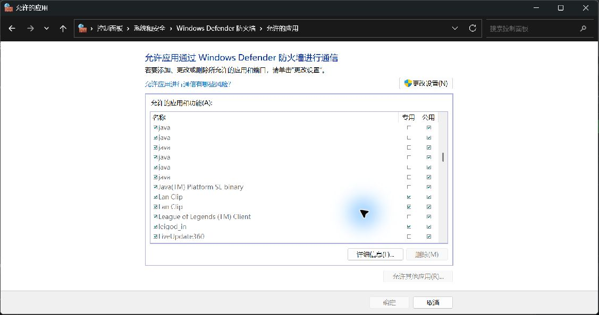

# Windows 首次连接与找不到电脑排查

适用于轻贴 v0.2.1。下面的界面截图来自 Windows 11，Windows 10 的部分入口名称可能略有不同。

手机搜不到电脑时，先检查轻贴是否正在运行、手机与电脑是否在同一局域网，再检查应用放行规则。**保持 Windows 防火墙开启，让轻贴通过防火墙即可。**

## 1. 允许轻贴通过防火墙

打开：

**控制面板 → 系统和安全 → 允许应用通过 Windows 防火墙**

也可以从 **Windows 安全中心 → 防火墙和网络保护 → 允许应用通过防火墙** 进入。

1. 点「更改设置」，根据系统提示确认管理员权限。
2. 找到 **Lan Clip**，勾选应用名称前的复选框；在可信的专用网络中使用时，勾选该行的「专用」。
3. 点「确定」，回到手机轻贴重新查找电脑。

图中的两条 Lan Clip 都已勾选「专用」。截图也显示了已有的「公用」勾选，**这不表示首次设置必须同时放行公用网络**。请按自己实际使用的网络类型配置。

### 列表里没有 Lan Clip，或出现多条

- 点「允许其他应用」→「浏览」，选择**当前正在运行的** `lan_clip.exe`，添加后勾选相应网络类型。
- 安装版通常位于 `%LOCALAPPDATA%\Programs\Lan Clip\lan_clip.exe`；自定义安装目录或便携版，以实际位置为准。
- 出现多条时，可以选中条目查看「详细信息」中的程序路径。旧解压目录的规则不一定适用于新安装位置。

轻贴接收连接使用 **TCP 45877**，设备发现使用 **UDP 45876**。通常按程序放行即可；只允许 TCP，仍可能出现「手动 IP 能连接，但自动搜索不到」的情况。

参考：[微软的应用防火墙放行说明](https://support.microsoft.com/zh-cn/windows/security/firewall/risks-of-allowing-apps-through-windows-firewall)。

## 2. 确认当前网络类型

「专用网络防火墙已开启」和「当前网络属于专用网络」是两件事。若只放行了「专用」，但实际连接属于「公用」，该专用规则不会应用到这条连接。

在确认是自己信任的家庭或办公网络后，可以设置：

- **网线连接**：设置 → 网络和 Internet → 以太网 → 当前连接的属性 → 网络配置文件类型 → 专用网络。部分版本进入「以太网」后直接显示该选项。
- **Wi-Fi 连接**：设置 → 网络和 Internet → Wi-Fi → 当前连接的 Wi-Fi 属性 → 网络配置文件类型 → 专用网络。

这会同时应用系统中其他已有的专用网络规则，因此不要把酒店、咖啡店或不信任的网络改成专用。组织管理的电脑若无法修改，应联系管理员。

**如果轻贴已经被允许通过当前网络类型，就不必为了排查而反复切换公用／专用；切换成功也不能证明手机已经连通。**

参考：[微软的网络类型设置说明](https://support.microsoft.com/zh-cn/windows/experience/connectivity-networking/essential-network-settings-and-tasks-in-windows)。

## 3. 用手动 IP 区分发现失败与连接失败

1. 在 Windows 轻贴中打开「开始配对」或「添加手机」。
2. 查看配对页的地址；若列出多个，使用连接路由器的真实 Wi-Fi 或以太网 **IPv4 地址**。可在 Windows 当前网络属性中核对。不要选择 VPN、虚拟机网卡、`127.0.0.1` 或 `169.254.*` 地址。
3. 手机点「添加电脑」→「使用 IP 添加」，输入该地址和电脑显示的**完整配对码**。配对码两分钟后失效，过期需重新生成。

| 结果 | 下一步 |
| --- | --- |
| 手动 IP 可以配对、发送，自动搜索不到 | 重点检查 UDP 45876、路由器广播限制，以及 VPN／代理隧道对局域网流量的影响。 |
| 手动 IP 也连接失败或超时 | 检查地址、TCP 45877 的应用放行、电脑是否休眠，以及路由器设备隔离。 |
| 提示配对码不匹配或已过期 | 在电脑重新生成完整配对码，并核对选中的电脑；这与搜不到设备是不同阶段的问题。 |
| 规则已勾选，仍然无法连接 | 检查是否启用了「阻止所有传入连接，包括允许应用列表中的连接」，以及组织策略或第三方安全软件是否另有限制。 |

手动 IP 绕过的是自动发现，不能绕过防火墙或路由器的设备隔离。

## 4. 规则正常时，再检查网络环境

- 手机连接 Wi-Fi、电脑插网线也可以使用，但两者必须处于允许互相访问的局域网。访客 Wi-Fi、AP 隔离或有线／无线隔离可能阻断通信。
- 同时使用 VPN、Clash TUN、虚拟机网卡等时，检查其局域网绕过设置。若环境允许，可暂时停用相关隧道做对照测试，再恢复原设置。**发现虚拟网卡只能算排查线索，不能直接认定它就是原因。**
- Windows 的文件共享「网络发现」开关与轻贴自己的 UDP 发现协议不同；无需为轻贴开启文件或打印机共享。

防火墙开启、应用已放行、端口正常监听，甚至电脑能收到自己发出的发现请求，都只能说明本机对应环节正常。最终仍需用手机完成搜索、配对和发送验证。

参考：[微软的防火墙与网络保护说明](https://support.microsoft.com/zh-cn/windows/security/windows-security/firewall-and-network-protection-in-the-windows-security-app)。

[返回 README](../README.md)
